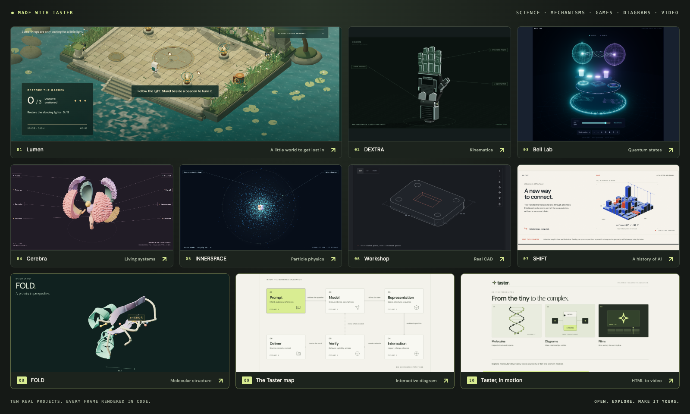

# Taster

Idiomas: [English](README.md) · **Español**

<a href="https://josoroma.github.io/taster/"></a>

**Ideas con las que puedes jugar, explorar y aprender.** [Explora la galería interactiva](https://josoroma.github.io/taster/) · [Visita el repositorio](https://github.com/josoroma/taster)

[](https://josoroma.github.io/taster/)

## Contenido

- [Acerca de Taster](#acerca-de-taster)
- [Qué permite hacer](#qué-permite-hacer)
- [Usar el skill](#usar-el-skill)
- [Ejecutar los siete proyectos incluidos](#ejecutar-los-siete-proyectos-incluidos)
- [Estructura del repositorio](#estructura-del-repositorio)
- [Iniciar un proyecto independiente](#iniciar-un-proyecto-independiente)
- [Compilar y verificar](#compilar-y-verificar)
- [Publicar con GitHub Pages](#publicar-con-github-pages)
- [Guía de lectura](#guía-de-lectura)
- [Créditos y límites](#créditos-y-límites)
- [Ejemplos](#ejemplos)
  - [Proyectos incluidos y sus prompts](#proyectos-incluidos-y-sus-prompts)
    - [Lumen](#lumen--the-sunken-garden)
    - [Bell Lab](#bell-lab)
    - [Workshop](#workshop)
    - [SHIFT](#shift)
    - [Cerebra](#cerebra)
    - [INNERSPACE](#innerspace)
    - [DEXTRA](#dextra)
  - [Más ideas de proyectos](#más-ideas-de-proyectos)
    - [Computación cuántica y átomos](#computación-cuántica-y-átomos)
    - [LLMs y computación](#llms-y-computación)
    - [Espacio y tiempo](#espacio-y-tiempo)
    - [Matemáticas y física](#matemáticas-y-física)
    - [Robótica y mecanismos](#robótica-y-mecanismos)
    - [CAD y fabricación](#cad-y-fabricación)
    - [Impresión 3D](#impresión-3d)
    - [Óptica y biología](#óptica-y-biología)
    - [Juegos para aprender](#juegos-para-aprender)
    - [Presentación y adaptación](#presentación-y-adaptación)

## Acerca de Taster

**Taster es un skill reutilizable para crear animaciones explicativas, modelos interactivos de ingeniería y mundos jugables.** Sus herramientas combinan escenas detalladas, exploración con la cámara, ensamblajes reversibles y animaciones basadas en un modelo.

Dale un tema, un público y la idea que quieres ayudar a descubrir. Taster elige una representación adecuada, construye el modelo, organiza la explicación y comprueba el resultado en un navegador. Puedes pedir un dibujo técnico sobrio, un mecanismo 3D que se pueda explorar, una escena científica cinematográfica o un pequeño juego completo sin tener que elegir primero una biblioteca de renderizado.

```text
$taster explica cómo una pinza robótica convierte la rotación del motor en movimiento de los dedos.
Usa una vista ortográfica sobria, resalta la articulación activa y permite recorrer
la línea de tiempo del mecanismo, explorar sus piezas y volver a ensamblarlo con exactitud.
```

## Qué permite hacer

| Función | Qué puede hacer quien la usa |
| --- | --- |
| Exploración con la cámara | Orbitar, acercar y alejar, desplazar la vista, enfocar una pieza, restablecer la vista o interrumpir un recorrido guiado. |
| Ensamblaje reversible | Separar componentes, explorar sus relaciones y volver a la posición ensamblada sin acumular desviaciones. |
| Animación explicativa | Reproducir, pausar, avanzar por capítulos, retroceder en la línea de tiempo y cambiar la velocidad de reproducción. |
| Modelos científicos | Vincular la geometría, las ecuaciones, las lecturas y los textos explicativos a un mismo estado; identificar los supuestos y las metáforas visuales. |
| Ingeniería sobria | Explorar trazados ortográficos, aristas ocultas, cotas, etapas de construcción, sistemas de referencia robóticos o trayectorias de deposición. |
| Experiencias jugables | Aprender reglas, actuar sobre un modelo, recibir respuestas a sus acciones, alcanzar un final claro y reiniciar. |
| Exploración accesible | Usar alternativas de teclado y controles táctiles, movimiento reducido, textos legibles y diseños adaptables. |

El skill adapta la presentación al tema. Las explicaciones de ingeniería usan, por defecto, superficies discretas y líneas precisas. Las escenas científicas pueden incorporar iluminación cinematográfica cuando ayuda a aclarar la idea. Incluir un juego es opcional, y las afirmaciones científicas poco conocidas necesitan fuentes adecuadas.

## Usar el skill

Conserva el repositorio completo al instalar el skill; `SKILL.md` enlaza las guías, las utilidades de ejecución y los ejemplos completos. Desde la raíz de este repositorio, crea un enlace en tu directorio de skills:

```sh
mkdir -p "$HOME/.agents/skills"
ln -s "$PWD" "$HOME/.agents/skills/taster"
```

Si el destino ya existe, revísalo antes de cambiar nada. Invoca **`$taster`** en un prompt o selecciona **Taster** en el selector de skills. Puede ser necesario iniciar una nueva sesión después de instalarlo. El repositorio se llama `taster`; su identificador en los prompts es `$taster`.

Un prompt útil indica el tema, el público, la pregunta central, la interacción deseada y el estilo visual. Añade los archivos proporcionados, las unidades, los supuestos científicos o los formatos de exportación requeridos cuando sean relevantes. Deja abiertas las decisiones de implementación, salvo que ya tengas tecnologías o un flujo de trabajo que quieras conservar. Consulta los [proyectos incluidos y los prompts adicionales](#ejemplos) como punto de partida.

## Ejecutar los siete proyectos incluidos

Los siete proyectos completos se encuentran en [`examples/`](examples/README.md). Comparten fuentes tipográficas locales y utilidades de ejecución desde la raíz del repositorio.

Requisitos: **Node.js 22+** y un navegador moderno. Los ejemplos 3D necesitan WebGL 2; SHIFT usa Canvas 2D. La reproducción no necesita claves de API ni recursos remotos.

```sh
npm ci
npm start
```

Abre la [galería local](http://localhost:5173/taster/) o explora la [galería pública](https://josoroma.github.io/taster/) sin instalar nada. La sección final [Proyectos incluidos y sus prompts](#proyectos-incluidos-y-sus-prompts) reúne cada proyecto con su carpeta de código fuente, sus vistas previas pública y local y un prompt reutilizable.

Usa `PORT=8080 npm start` para elegir otro puerto. Los enlaces a las vistas previas locales funcionan mientras el servidor está en ejecución; no son despliegues públicos.

## Estructura del repositorio

```text
taster/
├── SKILL.md                     Punto de entrada del skill y principios de trabajo
├── agents/openai.yaml           Metadatos para descubrir el skill
├── README.md                    Instalación, guía de proyectos y colección de prompts
├── README-ES.md                 Versión en español de esta guía
├── index.html                   Galería pública con enlaces a los ejemplos en ejecución
├── kit/                         Cámara, línea de tiempo, ensamblaje y visor técnico
├── assets/fonts/                Fuentes locales compartidas y avisos de licencia
├── assets/showcase/             Logotipo de Taster, capturas de pantalla y collage
├── examples/
│   ├── README.md                Resumen de los ejemplos y notas para adaptarlos
│   ├── index.html               Catálogo con enlaces a los siete ejemplos
│   ├── lumen/                   Página del juego, estilos, código fuente y guía
│   ├── bell-lab/                Página de computación cuántica, estilos y código fuente
│   ├── workshop/                Página CAD, estilos, código fuente y recursos CAD
│   ├── ai-history/              Película animada, modelo de capítulos y guía del código
│   ├── brain-atlas/             Cerebro 3D, información de sus regiones y ensamblaje
│   ├── particle-atlas/          Viaje al interior de la materia y atlas de partículas conocidas
│   └── cyborg-hand/             Mano articulada, recorrido del mecanismo y exploración
├── references/                  Guías de movimiento, ciencia, ingeniería y ejecución
├── scripts/                     Generación, compilación, reconstrucción CAD y comprobaciones del navegador
├── tests/                       Comprobaciones de modelos, geometría y movimiento
└── evals/evals.json              Prompts y criterios de evaluación del skill
```

Cada ejemplo mantiene juntos su HTML, el código de la aplicación, los estilos y los módulos de escena y modelo. La geometría generada, el código Python y los archivos exportados de Workshop están en [`examples/workshop/assets/cad-plate/`](examples/workshop/assets/cad-plate/README.md). Las utilidades compartidas permanecen en `kit/`; el generador copia las dependencias que necesita cada proyecto nuevo.

## Iniciar un proyecto independiente

Elige el ejemplo más cercano a tu idea y genera el proyecto en un directorio vacío:

```sh
node scripts/create-project.mjs /path/to/new-project --template bell-lab
cd /path/to/new-project
npm ci
npm start
```

| Plantilla | Punto de partida para |
| --- | --- |
| `bell-lab` | Explicaciones científicas guiadas, ensamblaje reversible, lecturas del modelo en tiempo real y retos opcionales. |
| `lumen` | Un mundo de juego que se puede explorar, con movimiento, objetivos y un final. |
| `workshop` | Explicaciones de ingeniería sobrias con etapas de construcción y exploración técnica. |
| `ai-history` | Relatos animados breves con capítulos, una línea de tiempo reversible y contexto respaldado por fuentes. |
| `brain-atlas` | Estructuras biológicas etiquetadas, separación reversible y exploración con información contextual. |
| `particle-atlas` | Recorridos guiados por distintas escalas científicas, exploración de partículas y clasificación respaldada por fuentes. |
| `cyborg-hand` | Mecanismos articulados, separación reversible de la cubierta exterior y exploración con una estética futurista sobria. |

El generador copia un ejemplo, las herramientas que necesita, los recursos locales, las pruebas y los scripts. El proyecto generado funciona de forma independiente del skill instalado. Adapta en conjunto el modelo, las etiquetas, las representaciones visuales y el objetivo de aprendizaje; cambiar de tema suele exigir algo más que sustituir textos.

Los proyectos existentes pueden incorporar utilidades individuales sin tener que empezar de nuevo. Lee la [API de ejecución](references/kit.md) antes de integrarlas.

## Compilar y verificar

```sh
npm test
npm run build
```

Las pruebas cubren el comportamiento del modelo y las propiedades de la geometría o el movimiento que deben mantenerse. La compilación de producción genera un directorio estático `dist/` con dependencias locales. Sírvelo mediante HTTP; la carga directa con `file://` no es compatible.

Usa [`scripts/capture.mjs`](scripts/capture.mjs) y [`scripts/drive.mjs`](scripts/drive.mjs) para obtener capturas del navegador y comprobar las interacciones. La [guía de ejecución](references/kit.md) explica su uso. Revisa los diseños de escritorio y de pantalla estrecha, los controles de teclado, el movimiento reducido, las acciones de pausar, recorrer la línea de tiempo y reiniciar, y el estado final real. Prueba por separado un proyecto generado para detectar dependencias accidentales de la copia local del repositorio del skill.

Workshop incluye geometría CAD precalculada. Para regenerar sus representaciones por etapa y los archivos de exportación reales a partir del código Python incluido, instala `uv` y ejecuta:

```sh
uv run scripts/build-cad-example.py
```

El generador fija la versión de SMLibPy y valida la geometría. La reproducción normal en el navegador no necesita Python ni un servicio CAD. Consulta la [guía de recursos CAD](examples/workshop/assets/cad-plate/README.md) para conocer el código fuente, las unidades, los detalles del mallado y los archivos exportados.

## Publicar con GitHub Pages

La galería pública está en **[josoroma.github.io/taster](https://josoroma.github.io/taster/)**. Publica los mismos proyectos completos de `examples/`, por lo que las vistas previas y el código fuente permanecen juntos sin una copia aparte en `examples-io/`.

El [flujo de trabajo de GitHub Actions](.github/workflows/pages.yml) compila y despliega el sitio cuando llegan cambios a `main`; también se puede iniciar manualmente desde la pestaña Actions del repositorio. Instala las dependencias con sus versiones fijadas, ejecuta las pruebas, compila con `npm run build` y publica `dist/` en GitHub Pages. En **Settings → Pages** del repositorio, elige **GitHub Actions** como origen.

Para comprobar localmente los archivos estáticos exactos que se publicarán:

```sh
npm ci
npm test
npm run build
python3 -m http.server 8080 --directory dist
```

Abre `http://localhost:8080/`. Los archivos generados incluyen la galería, los ejemplos, las herramientas, las fuentes tipográficas y las dependencias de renderizado incluidas localmente. Los enlaces relativos funcionan tanto aquí como bajo la ruta `/taster/` de GitHub Pages.

## Guía de lectura

| Guía | Cuándo consultarla |
| --- | --- |
| [Punto de entrada del skill](SKILL.md) | Invocación, decisiones automáticas, flujo de trabajo y criterios de finalización. |
| [Cámara y ensamblaje](references/camera-and-assembly.md) | Control de la cámara, recorridos, enfoque, trayectorias de separación, reensamblaje y navegación por la línea de tiempo. |
| [Narración científica](references/scientific-storytelling.md) | Fuentes, representaciones visuales fieles, supuestos del modelo y errores frecuentes de cada disciplina. |
| [Explicaciones de ingeniería](references/engineering-explainers.md) | Construcción CAD, robótica, fabricación aditiva, convenciones de líneas y exportaciones reales. |
| [API de ejecución](references/kit.md) | Firmas de las utilidades, ejemplos de integración, copia de proyectos y verificación en el navegador. |
| [Ejemplos funcionales](examples/README.md) | Qué demuestra cada proyecto incluido y cómo adaptarlo. |
| [Casos de evaluación](evals/evals.json) | Solicitudes realistas y comportamientos que debe cumplir un buen resultado. |

## Créditos y límites

Three.js usa la licencia MIT; las compilaciones incluyen su aviso. Las fuentes locales DM Sans e Italiana usan la SIL Open Font License, con avisos en `assets/fonts/`. Consulta [LICENSE](LICENSE) para ver la licencia de Taster y los avisos de terceros que la acompañan. Workshop usa geometría generada con [SMLibPy](https://smlibpy.classcad.ch/) 0.3.1.

Taster es un skill y un conjunto de herramientas reutilizables, no un simulador para todos los temas que aparecen en los prompts siguientes. Bell Lab modela un sistema ideal de dos cúbits; su equipo es una metáfora visual. Lumen es un mundo de juego artístico. Workshop ofrece una construcción CAD reproducible, con geometría sólida STEP y una malla STL a escala milimétrica. No controla una impresora ni incluye un laminador, y la guía de robótica no incorpora un motor de dinámica robótica.

SHIFT ilustra algunos avances de la IA desde 2017 y presenta la inteligencia artificial general (AGI) como una meta de investigación abierta. Cerebra usa formas y límites regionales esquemáticos del cerebro; la separación sirve para facilitar la exploración, y sus descripciones destacan las redes conectadas.

INNERSPACE ilustra la estructura conocida de las partículas y la clasificación del Modelo Estándar. Sus nubes, transiciones de escala y rotación de la vista son esquemáticas; el espín cuántico es intrínseco y no se afirman constituyentes más profundos de los quarks o los leptones.

DEXTRA es una demostración cinemática conceptual: las posiciones de las articulaciones y la separación dependen de un modelo determinista. Su geometría generada por código es ilustrativa y no incluye un análisis de fuerzas validado, tolerancias de fabricación ni exportaciones CAD para producción.

Los nuevos temas requieren modelos y fuentes adecuados. La exportación de video no está incluida; los ejemplos actuales son experiencias para navegador con código fuente editable y soporte para capturas de imágenes. Cualquier exportación o simulación nueva que se solicite necesita su propia implementación y verificación.

## Ejemplos

Elige un proyecto incluido para explorar una implementación funcional, o usa las ideas adicionales para comenzar algo nuevo. Cada prompt aparece una sola vez. Adapta el público, los archivos fuente, las dimensiones y el objetivo de aprendizaje a tu proyecto.

### Proyectos incluidos y sus prompts

Estos siete proyectos están disponibles en `examples/`. Cada entrada incluye su vista previa pública y un prompt reutilizable que describe el proyecto. Las vistas previas locales requieren el [servidor local](#ejecutar-los-siete-proyectos-incluidos).

#### Lumen — The Sunken Garden

Código fuente: [`examples/lumen/`](examples/lumen/) · [Jugar en línea](https://josoroma.github.io/taster/examples/lumen/) · [Vista previa local](http://localhost:5173/taster/examples/lumen/)

```text
$taster crea una aventura completa para el navegador en un jardín mecánico sumergido.
Permite al jugador guiar a un guardián mecánico, esquivar centinelas con impulsos
rápidos y restaurar tres balizas mediante desafíos de sincronización para volver
a abrir la puerta final. Usa un renderizado 3D con ambientación envolvente,
sonido opcional, objetivos claros, controles de teclado y puntero, y un final
satisfactorio que invite a volver a jugar.
```

#### Bell Lab

Código fuente: [`examples/bell-lab/`](examples/bell-lab/) · [Abrir en línea](https://josoroma.github.io/taster/examples/bell-lab/) · [Vista previa local](http://localhost:5173/taster/examples/bell-lab/)

```text
$taster crea una lección interactiva para principiantes sobre cómo preparar
un estado de Bell. Permíteme aplicar puertas H, X, Z y X controlada, inspeccionar
amplitudes y probabilidades conjuntas, y después resolver tres desafíos de estados
objetivo que incluyan la fase relativa. Añade inspección con la cámara y un
ensamblaje reversible, e identifica el aparato como una metáfora visual.
```

#### Workshop

Código fuente: [`examples/workshop/`](examples/workshop/) · [Abrir en línea](https://josoroma.github.io/taster/examples/workshop/) · [Vista previa local](http://localhost:5173/taster/examples/workshop/)

```text
$taster explica una placa de montaje construida a partir de un prisma rectangular,
con esquinas redondeadas, cuatro agujeros y una cavidad ciega. Usa un renderizado
técnico sobrio e instantáneas CAD reales vinculadas al código fuente ejecutado.
Muestra las dimensiones y el volumen correspondientes a cada etapa, permite
desplazar y ampliar la vista e incluye exportaciones STEP y STL validadas.
```

#### SHIFT

Código fuente: [`examples/ai-history/`](examples/ai-history/) · [Ver en línea](https://josoroma.github.io/taster/examples/ai-history/) · [Vista previa local](http://localhost:5173/taster/examples/ai-history/)

```text
$taster crea una animación de 90 segundos para el navegador, renderizada mediante
código, sobre la IA: desde Attention Is All You Need en 2017 hasta la cuestión
abierta de la AGI. Explica hitos seleccionados mediante metáforas visuales
originales, textos legibles, controles por capítulos y una línea de tiempo
reversible. Cita fuentes primarias y separa claramente las posibilidades futuras
de la historia establecida; no inventes una fecha de llegada de la AGI.
```

#### Cerebra

Código fuente: [`examples/brain-atlas/`](examples/brain-atlas/) · [Explorar en línea](https://josoroma.github.io/taster/examples/brain-atlas/) · [Vista previa local](http://localhost:5173/taster/examples/brain-atlas/)

```text
$taster construye una explicación interactiva del cerebro en 3D con regiones
identificadas, pistas e información contextual. Permíteme orbitar, desplazar
y ampliar la vista, seleccionar una región, separar las partes para inspeccionar
estructuras profundas y volver a ensamblarlas con exactitud. Explica cómo
funcionan las regiones mediante redes conectadas e identifica las formas y la
separación como esquemas educativos, no como un atlas clínico.
```

#### INNERSPACE

Código fuente: [`examples/particle-atlas/`](examples/particle-atlas/) · [Explorar en línea](https://josoroma.github.io/taster/examples/particle-atlas/) · [Vista previa local](http://localhost:5173/taster/examples/particle-atlas/)

```text
$taster crea un viaje de 78 segundos desde un átomo de helio hasta su núcleo,
sus protones y neutrones, y sus quarks, para terminar con un atlas de las partículas
elementales conocidas. Usa diagramas 3D que giren, ampliación y desplazamiento
de la vista, etiquetas y reproducción reversible. Permíteme comparar las cargas
de los quarks de valencia del protón y del neutrón e inspeccionar las funciones,
la carga y el espín de las partículas. Distingue la rotación de la representación
del espín cuántico y detente en la estructura confirmada antes de presentar
las preguntas de investigación abiertas.
```

#### DEXTRA

Código fuente: [`examples/cyborg-hand/`](examples/cyborg-hand/) · [Inspeccionar en línea](https://josoroma.github.io/taster/examples/cyborg-hand/) · [Vista previa local](http://localhost:5173/taster/examples/cyborg-hand/)

```text
$taster crea una mano cíborg futurista que se extienda por completo y se cierre
en un puño mediante articulaciones y un pulgar oponible. Usa grafito, una cubierta
protectora plateada y detalles verdes discretos. Añade desplazamiento, ampliación
y órbita de la cámara, vistas predefinidas, etiquetas de componentes, ángulos de
las articulaciones en tiempo real y un estudio de movimiento reversible de
32 segundos. Permite separar la mano abierta en capas que puedan inspeccionarse
y volver a ensamblarse con exactitud. Trátala como un mecanismo cinemático
conceptual, sin afirmaciones no fundamentadas sobre fuerzas o fabricación.
```

### Más ideas de proyectos

Los siguientes 47 prompts describen proyectos adicionales o adaptaciones. Sus temas no se incluyen como ejemplos completos; el agente debe implementar y verificar el modelo y las interacciones solicitados.

#### Computación cuántica y átomos

**Interferencia cuántica**

```text
$taster explica un interferómetro de un solo cúbit con un control de fase
y probabilidades de salida medidas. Vincula cada cambio visual con el cálculo
del estado y permíteme comparar la evolución coherente con un modelo de pérdida
de coherencia de fase claramente identificado.
```

**Un orbital de hidrógeno**

```text
$taster construye una explicación pausada en 3D de los orbitales 1s y 2p del
hidrógeno para estudiantes de secundaria. Permíteme rotar y seccionar la densidad
de probabilidad, distingue el signo de la amplitud de la probabilidad y evita
mostrar un electrón siguiendo una órbita como la de un planeta.
```

**Corrección de errores cuánticos**

```text
$taster explica el código de tres cúbits para corregir inversiones de bit mediante
un circuito pequeño que pueda inspeccionarse. Permíteme introducir un error X,
leer el síndrome y recuperar el estado codificado; deja explícito que este código
no puede corregir errores cuánticos arbitrarios.
```

**Entrelazamiento y medición**

```text
$taster crea una explicación del entrelazamiento con dos estaciones en las que
pueda elegir bases de medición locales y comparar las estadísticas tras reunir
ambos registros. Muestra por qué las correlaciones no permiten enviar un mensaje
controlable a una velocidad superior a la de la luz.
```

#### LLMs y computación

**Atención que puedes calcular**

```text
$taster explica una cabeza de atención mediante una secuencia diminuta y vectores
numéricos visibles de consulta, clave y valor. Permíteme inspeccionar los productos
escalares, el escalado, softmax y la salida ponderada, con todos los valores
mostrados procedentes del mismo cálculo.
```

**Dentro de un bloque transformer**

```text
$taster crea una explicación sobria de un bloque transformer con capas separables
y un recorrido del token que pueda explorar ajustando la línea de tiempo.
Especifica la arquitectura utilizada, muestra las conexiones residuales
y distingue las representaciones aprendidas de los conceptos humanos literales.
```

**Generación autorregresiva y caché KV**

```text
$taster muestra cómo un decodificador pequeño genera un token a la vez y reutiliza
una caché KV. Permíteme comparar la ejecución con y sin caché, incluida la máscara
causal y el recuento real de operaciones del modelo de demostración, en lugar
de inventar tiempos de ejecución.
```

**Retropropagación**

```text
$taster construye una explicación interactiva de la retropropagación en una red
diminuta de dos capas. Permíteme cambiar un peso, inspeccionar la pérdida calculada
en la propagación hacia delante y el gradiente obtenido con la regla de la cadena,
y comparar ese gradiente con una comprobación mediante diferencias finitas.
```

**Paquetes, colas y reintentos**

```text
$taster crea una simulación de red compacta que muestre paquetes recorriendo
colas de capacidad limitada. Permíteme variar la latencia, la capacidad y las
pérdidas, y explica cómo una política de reintentos especificada afecta a la entrega,
sin presentar el movimiento decorativo como datos de tiempos reales.
```

#### Espacio y tiempo

**Estructura de un agujero negro**

```text
$taster crea una explicación guiada de un agujero negro con vistas de inspección
del horizonte, la región de fotones, la sombra y el disco de acreción. Identifica
qué formas son esquemáticas y qué efectos ópticos se calculan, y mantén la escala
fácil de interpretar.
```

**Dilatación gravitacional del tiempo**

```text
$taster compara relojes estacionarios a distintas distancias radiales fuera de un
agujero negro sin rotación. Permíteme ajustar el radio e inspeccionar la relación
entre sus ritmos de marcha a partir de una ecuación explícita; mantén todos los
ejemplos de relojes estacionarios fuera del horizonte e indica los supuestos.
```

**Conos de luz y simultaneidad**

```text
$taster explica la relatividad especial con un diagrama de espacio-tiempo de
1+1 dimensiones. Permíteme cambiar de sistema de referencia inercial, seguir los
mismos sucesos y comparar los cortes de simultaneidad mientras los conos de luz
y el intervalo invariante se mantienen coherentes.
```

**Transferencia entre órbitas**

```text
$taster construye una lección jugable sobre una transferencia de Hohmann entre
órbitas circulares. Permíteme elegir el radio de destino e inspeccionar ambos
impulsos y el tiempo de vuelo sin propulsión. Distingue el cálculo ideal de dos
cuerpos de una trayectoria lista para una misión real.
```

**El espacio en expansión**

```text
$taster explica la expansión cosmológica mediante un factor de escala ajustable
y marcadores comóviles. Muestra la diferencia entre distancia comóvil y distancia
propia, e indica la simplificación dimensional de la visualización y el modelo
de expansión elegido.
```

#### Matemáticas y física

**Síntesis de Fourier**

```text
$taster permite que un estudiante construya una señal periódica a partir de armónicos
con controles de amplitud y fase. Sincroniza los fasores giratorios, las ondas
componentes y su suma; después, añade un reto para reproducir una forma de onda
objetivo dentro de una tolerancia de error visible.
```

**Un péndulo doble**

```text
$taster crea una simulación de un péndulo doble que se pueda inspeccionar, con dos
condiciones iniciales cercanas y lecturas de energía. Utiliza un integrador adecuado,
muestra la deriva numérica e incorpora a la explicación la pausa, el reinicio y
unas condiciones iniciales reproducibles.
```

**Los vectores propios como direcciones**

```text
$taster explica una transformación lineal real de 2×2 mediante una base que se pueda
arrastrar y una cuadrícula animada. Permíteme identificar direcciones invariantes y
comparar matrices con vectores propios reales distintos, un valor propio repetido
o ningún vector propio real.
```

**Ondas en una frontera**

```text
$taster muestra cómo un pulso se refleja y se transmite en la frontera entre dos
medios unidimensionales. Permíteme cambiar los parámetros relevantes de los
materiales y observar las condiciones de frontera, las velocidades de propagación
y el balance de energía del modelo elegido.
```

**Difusión a partir de caminatas aleatorias**

```text
$taster explica la difusión comparando caminatas aleatorias con una semilla definida
y un perfil de concentración. Permíteme cambiar la frecuencia de los pasos e
inspeccionar el desplazamiento cuadrático medio, distinguiendo claramente las
trayectorias individuales de las estadísticas del conjunto.
```

#### Robótica y mecanismos

**Muñeca robótica y sistemas de coordenadas**

```text
$taster crea una explicación 3D sobria de una muñeca robótica de tres ejes, con ejes
articulares visibles y sistemas de coordenadas locales seleccionables. Permíteme
mover una articulación a la vez, inspeccionar la cadena de transformaciones y
reiniciar sin mezclar el movimiento de funcionamiento con las posiciones explosionadas.
```

**Cinemática inversa de dos eslabones**

```text
$taster construye un brazo plano de dos eslabones cuyo objetivo para el efector final
pueda arrastrar. Muestra ambas ramas de solución de la cinemática inversa, los límites
articulares y el espacio de trabajo alcanzable; señala los objetivos inalcanzables
en lugar de estirar los eslabones para llegar a ellos.
```

**Pinza paralela**

```text
$taster explica cómo una pinza de piñón y cremallera convierte la rotación del motor
en desplazamientos iguales y opuestos de sus dedos. Utiliza trazos sobrios, un
control de posición articular y una vista explosionada reversible que revele cómo
los dientes y las guías restringen el movimiento.
```

**Mecanismo de cuatro barras**

```text
$taster crea una explicación de un mecanismo de cuatro barras con longitudes de
eslabón editables y una manivela accionada. Conserva el cierre del lazo, explica las
configuraciones no válidas y muestra la trayectoria del acoplador sin dar a entender
que el modelo cinemático incluye fuerzas.
```

**Inspeccionar un modelo de robot proporcionado**

```text
$taster utiliza el URDF y las mallas de este proyecto para crear una herramienta
de inspección en el navegador. Conserva los orígenes, ejes articulares, límites y
unidades declarados, y añade un breve recorrido de cámara por la cadena cinemática
y un control para restablecer la postura de inicio.
```

#### CAD y fabricación

**Revolución, transición y barrido**

```text
$taster crea tres animaciones de construcción sobrias, una al lado de la otra,
que comparen revolución, transición entre perfiles (loft) y barrido. Resalta el
perfil, el eje o la trayectoria, y después la superficie o el sólido resultante,
con selección directa de etapas y un encuadre de cámara uniforme.
```

**Una sección de un rodamiento**

```text
$taster explica el conjunto de rodamiento proporcionado mediante un plano de corte
móvil. Cierra las caras del corte y aplica un rayado a la sección, conserva un
contorno sin cortar para orientar la vista y permíteme aislar los aros, los elementos
rodantes y la jaula antes de restaurar el conjunto.
```

**Tolerancias y ajustes**

```text
$taster construye una explicación de un eje y un agujero con límites de diámetro
ajustables. Calcula el juego o la interferencia a partir de las dimensiones
indicadas, exagera la separación solo en una vista de detalle etiquetada y evita
inventar una afirmación de cumplimiento de normas.
```

**Orden de montaje**

```text
$taster convierte las piezas CAD proporcionadas en una lección de montaje con
componentes identificados por nombre y una secuencia de pasos reversible. Utiliza
direcciones de inserción plausibles, mantén visibles las referencias de acoplamiento
e identifica cualquier interferencia sin resolver en lugar de ocultarla.
```

#### Impresión 3D

**Del sólido a las capas**

```text
$taster explica cómo un modelo FDM se convierte en cortes horizontales, perímetros
y relleno. Permíteme mover el plano de corte y cambiar una altura de capa ilustrativa,
mostrando las dimensiones y distinguiendo claramente las trayectorias esquemáticas
de la salida de un programa laminador.
```

**Inspeccionar G-code real**

```text
$taster visualiza el G-code de impresora proporcionado como una explicación de solo
lectura. Interpreta sus modos de coordenadas y extrusión, distingue la deposición
de los desplazamientos sin extrusión y sincroniza la posición de la boquilla, el
material visible y la selección de capa al recorrer la línea de tiempo.
```

**Soportes y orientación**

```text
$taster compara tres orientaciones de impresión de un mismo soporte y explica por
qué los voladizos pueden necesitar estructuras de soporte. Permíteme inspeccionar
secciones transversales y posibles regiones de soporte; indica los supuestos del
proceso en lugar de garantizar automáticamente que la pieza sea imprimible.
```

**Secuencia de impresión con resina**

```text
$taster crea una explicación sobria de la impresión con resina mediante máscara,
de abajo hacia arriba. Muestra la capa de exposición seleccionada, el movimiento
de la plataforma de construcción y la etapa de separación en una misma línea de
tiempo reversible, con una nota clara cuando se compriman los tiempos del proceso.
```

**Patrones de relleno**

```text
$taster compara rellenos de cuadrícula, triangulares y de tipo giroide dentro de
una pieza seccionada. Permíteme ajustar la densidad nominal e inspeccionar la
distribución del material, pero separa las observaciones geométricas de las
afirmaciones sobre resistencia mecánica que requieran simulaciones o ensayos.
```

#### Óptica y biología

**Objetivo de cámara en vista explosionada**

```text
$taster crea una explicación sobria de un objetivo con separación reversible de
sus elementos ópticos y láminas del diafragma, identificados por nombre. Añade un
modelo sencillo de rayos con supuestos explícitos y muestra cómo el enfoque y la
apertura afectan a los rayos calculados, no solo a la vista de la cámara.
```

**Interferencia en películas delgadas**

```text
$taster explica la interferencia en películas delgadas con controles de espesor,
índice de refracción y longitud de onda. Traza las trayectorias relevantes, incluye
los cambios de fase por reflexión y relaciona la intensidad mostrada con un modelo
óptico explícito.
```

**Replicación del ADN**

```text
$taster crea una explicación guiada de la replicación del ADN para un curso
introductorio de biología. Permíteme inspeccionar la dirección de las cadenas y
comparar la síntesis de la cadena conductora con la de la retardada, con controles
por capítulos y simplificaciones explícitas de escala o movimiento en la escena molecular.
```

**El ciclo cardíaco**

```text
$taster explica el ciclo cardíaco mediante un modelo simplificado de cámaras y
válvulas. Sincroniza las relaciones de presión, los estados de las válvulas y la
dirección del flujo en una línea de tiempo que se pueda recorrer, e identifícalo
como un esquema educativo, no como datos de un paciente.
```

**Cinética enzimática**

```text
$taster conecta una animación de unión de una enzima con un pequeño modelo cinético
que muestre sus supuestos y permita ajustar la concentración de sustrato. Compara
la velocidad calculada con la predicción del modelo elegido e identifica cuándo
se utilizan supuestos de estado estacionario.
```

#### Juegos para aprender

**Rompecabezas de encuentro orbital**

```text
$taster crea un pequeño juego de encuentro orbital con un presupuesto limitado
de maniobras. Utiliza un modelo coherente de dos cuerpos, enseña los controles
mediante el primer reto y define el éxito tanto por la distancia como por la
velocidad relativa, con una opción clara para reiniciar.
```

**Laboratorio de espejos**

```text
$taster crea un juego de rompecabezas en el que gire espejos para dirigir un haz
a través de objetivos. Utiliza direcciones de reflexión calculadas y reglas de
colisión visibles, añade cinco niveles cuidadosamente diseñados y permíteme
inspeccionar los ángulos de incidencia y reflexión.
```

**Taller de trenes de engranajes**

```text
$taster crea un juego de montaje de trenes de engranajes para alcanzar una relación
de transmisión objetivo. Mantén la coherencia entre el número de dientes, los
sentidos de giro y la geometría de engrane, y explica un montaje fallido mediante
el mecanismo en lugar de mostrar únicamente una puntuación en rojo.
```

**Reto robótico de recogida y colocación**

```text
$taster construye un juego cinemático de un brazo robótico con límites articulares
y tres objetivos de colocación. Proporciona controles manuales de las articulaciones
y una superposición del espacio de trabajo alcanzable, e indica exactamente qué
reglas de colisión o agarre implementa el juego simplificado.
```

#### Presentación y adaptación

**Dar sobriedad a una escena existente**

```text
$taster adapta esta explicación existente al estilo de ingeniería sobrio de mi
referencia: fondo de color carbón, vistas ortográficas, contornos claros y un color
de acento. Conserva su modelo y sus controles mientras sustituyes los efectos
decorativos por énfasis que tengan un propósito.
```

**Recorrido de cámara con inspección**

```text
$taster añade a este modelo un recorrido de cámara que se pueda interrumpir,
pasando de una vista general a tres mecanismos identificados por nombre y de
regreso. Permite que la interacción del usuario tome el control de inmediato,
proporciona botones para enfocar y encuadrar todo, y mantén legible cada parada
en pantallas estrechas.
```

**Separación y reensamblaje fiables**

```text
$taster añade una vista explosionada reversible a este conjunto utilizando sus
posiciones originales de reposo. Permíteme recorrer la línea de tiempo en cualquier
dirección, aislar una pieza y repetir la separación y el reensamblaje sin deriva;
elige trayectorias que comuniquen las relaciones de acoplamiento reales.
```

**Una versión accesible para el aula**

```text
$taster adapta esta explicación interactiva para usarla con teclado y en una tableta
de aula. Proporciona alternativas etiquetadas a los gestos, subtítulos legibles
y un modo opcional de movimiento reducido basado en pasos, sin eliminar los
controles significativos del modelo.
```

**Una ilustración técnica fija**

```text
$taster utiliza este mecanismo para producir una explicación SVG autónoma con
vista fija, una vista del conjunto montado, un detalle explosionado y etiquetas
concisas de las piezas. Mantén un carácter estático y editorial: da prioridad
a la jerarquía de líneas, las relaciones precisas y la legibilidad al ancho
previsto del artículo.
```
